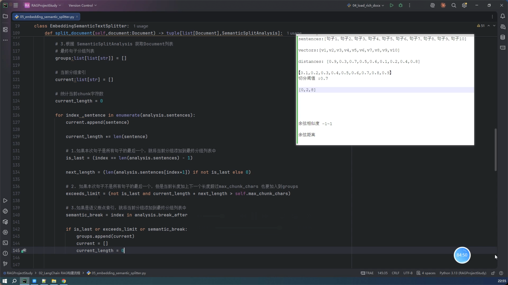

split_document 循环全过程（伪代码推演）

初始化: groups = [], current = [], current_length = 0

【循环开始】
----------------------------------------
index = 0:
  current.append("句0")  -> current = ["句0"]
  is_last = False, exceeds_limit = False, semantic_break = False
  判断: if (False or False or False) -> 不成立
  （继续攒着）

index = 1:
  current.append("句1")  -> current = ["句0", "句1"]
  semantic_break = False
  判断: 不成立

... (中间一直不成立，直到 index = 7) ...

index = 7:
  current.append("句7")  -> current = ["句0", "句1", ..., "句7"]
  is_last = False, exceeds_limit = False
  semantic_break = True  -> (因为 7 在 break_after=[7] 中)
  判断: if (False or False or True) -> ✅ 成立！
  动作: 
    groups.append(current) -> groups = [ ["句0" ~ "句7"] ]
    current = []           -> 清空！当前块重新开始
    current_length = 0

index = 8:
  current.append("句8")  -> current = ["句8"]
  semantic_break = False -> (因为 8 不在 break_after 中)
  判断: if (False or False or False) -> 不成立
  （第8句虽然之前算距离很大，但被过滤了，只能乖乖待在当前块）

index = 9:
  current.append("句9")  -> current = ["句8", "句9"]
  is_last = True         -> (因为 9 == 10 - 1)
  判断: if (True or ...) -> ✅ 成立！
  动作: 
    groups.append(current) -> groups = [ ["句0" ~ "句7"], ["句8", "句9"] ]
    current = []
【循环结束】
----------------------------------------

最终产出的 groups 结构
跑完之后，groups 会变成这样一个二维列表：

groups = [
    ["句0", "句1", "句2", "句3", "句4", "句5", "句6", "句7"], # 这是第一个 Chunk
    ["句8", "句9"]                                         # 这是第二个 Chunk
]